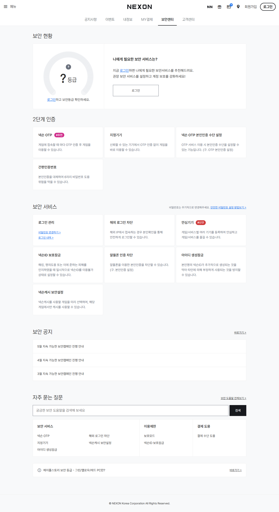
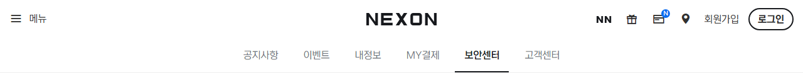
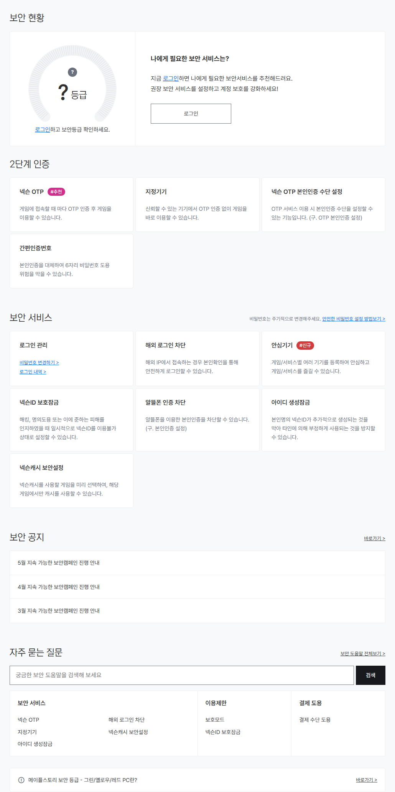
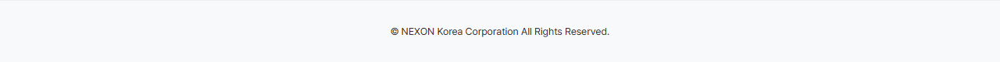
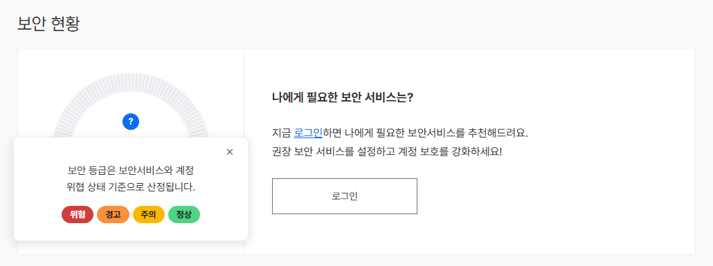
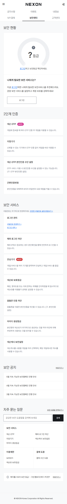

# 넥슨 보안센터 클론 코딩 (HTML · CSS)

넥슨 보안센터 페이지를 HTML과 CSS만으로 따라 만든 클론 코딩 과제입니다. 이전에 참여한 [프론트엔드 팀 스터디](https://github.com/Cocode96/AX-web-clone)에서 담당했던 페이지를 웹 접근성과 가독성, 재사용 가능한 스타일 구조를 갖춘 페이지로 재구성했습니다. 학습용 과제이며 NEXON과 관련이 없습니다.

- 원본 페이지 : https://security-center.nexon.com/

<br>

> **개발환경**
> 
> HTML · CSS

<br>

> **목차**
> 1. [구현 내용](#1-구현-내용)
> 2. [폴더 구조](#2-폴더-구조)
> 3. [구현 화면](#3-구현-화면)
> 4. [실행 방법](#4-실행-방법)
> 5. [제한 사항](#5-제한-사항)
> 6. [이미지와 출처](#6-이미지와-출처)

<br> 

## 1. 구현 내용

- **시맨틱 마크업** : `header`, `nav`, `main`, `section`, `aside`, `footer`, 제목 `h1`~`h3` 위계, 목록은 `ul > li`
- **폼** : 자주 묻는 질문의 보안 도움말 검색 폼 (`label`과 `input`을 `for`/`id`로 연결)
- **웹 접근성**: 이미지 `alt`, 아이콘 링크 `aria-label`, 현재 메뉴 `aria-current`, 본문 바로가기 링크, 키보드 포커스 표시, 새 창으로 열리는 링크 안내
- **레이아웃** : 헤더와 카드 목록은 Grid, 카드 내부와 메뉴는 Flexbox
- **반응형** : 1024px, 768px, 480px 기준으로 카드 열 수·헤더·메뉴 배치를 바꿈
- **재사용 가능한 스타일 구조** : CSS 변수(`variables.css`), 역할별 파일 분리, BEM 방식 클래스 이름, 공통 카드·알약·버튼 컴포넌트
- **보안 등급 안내 팝업** : 자바스크립트 없이 HTML `popover` 속성으로 구현

<br>

## 2. 폴더 구조

```
├─ index.html
├─ css/
│  ├─ variables.css    색상, 폰트, 간격 등 변수
│  ├─ base.css         초기화, 기본 태그 스타일
│  ├─ layout.css       헤더, 내비, 본문, 푸터의 큰 틀
│  ├─ components.css   카드, 버튼, 알약, 팝업 등 부품
│  └─ responsive.css   화면 크기별 규칙
├─ images/             직접 생성한 SVG (로고, 게이지, 아이콘, 파비콘)
└─ docs/screenshots/   README용 화면 캡처
```

<br>

## 3. 구현 화면

### 전체 화면


### 헤더


### 메인


### 푸터


### 보안 등급 안내 팝업


### 모바일 (폭 480px)
<details>
<summary>모바일 전체 화면 펼쳐 보기</summary>



</details>

<br>

## 4. 실행 방법

`index.html`을 브라우저로 실행합니다.
- 별도 설치나 빌드는 필요 없습니다.
- 아이콘(xeicon)과 폰트(Pretendard, NEXON Lv2 Gothic)를 CDN에서 불러오므로 인터넷 연결이 필요합니다. 
- 연결이 없으면 레이아웃은 유지되지만 아이콘이 보이지 않고 기본 글꼴로 표시됩니다.

<br>

## 5. 제한 사항

- 로그인 후 화면(등급 게이지 변화 등)은 구현하지 않았습니다.
- 햄버거 메뉴는 모양만 있고 열리지 않습니다.
- 검색 폼은 화면 구성만 있고 실제 검색은 동작하지 않습니다.
- 원본에서 주소를 확인한 외부 링크 11개만 연결했고, 나머지 링크는 `#`로 남겨 두었습니다.
- 팝업의 위치 지정(CSS 앵커 포지셔닝)은 Microsoft Edge에서만 확인했습니다. 지원하지 않는 브라우저에서는 화면 가운데에 표시됩니다.

<br>

## 6. 이미지와 출처

- 로고, 등급 게이지, 아이콘 일부, 파비콘은 원본 이미지를 사용하지 않고 직접 생성한 SVG입니다.
- 아이콘은 [XEIcon](https://github.com/xpressengine/xeicon), 폰트는 Pretendard와 NEXON Lv2 Gothic을 CDN으로 불러옵니다. 각 라이선스는 배포처를 따릅니다.
- 화면 문구는 원본 페이지를 참고했습니다.
